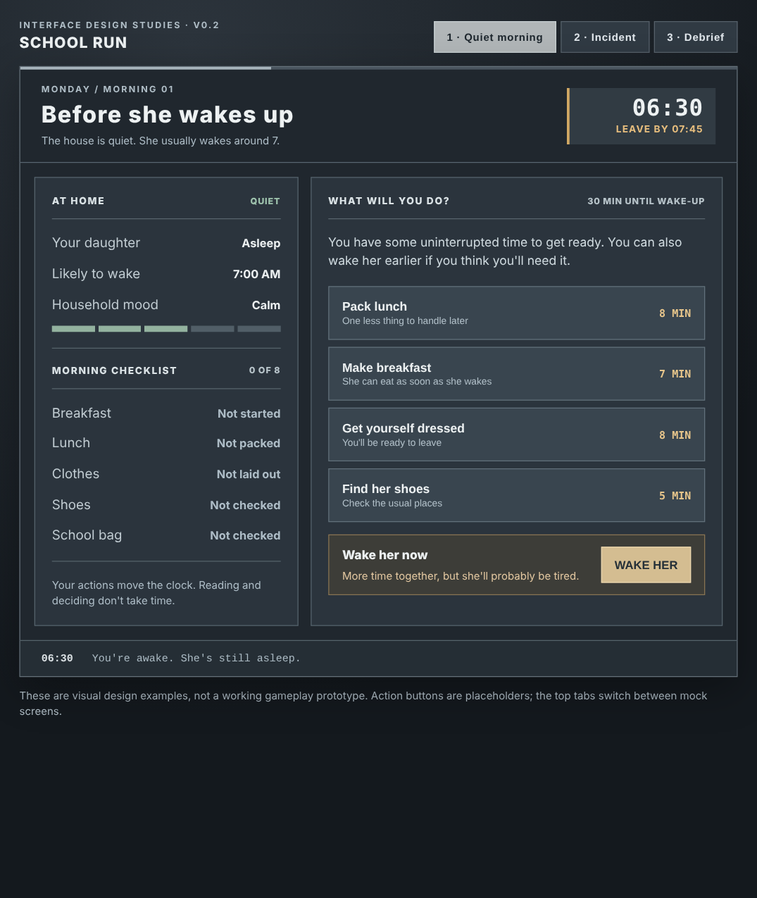
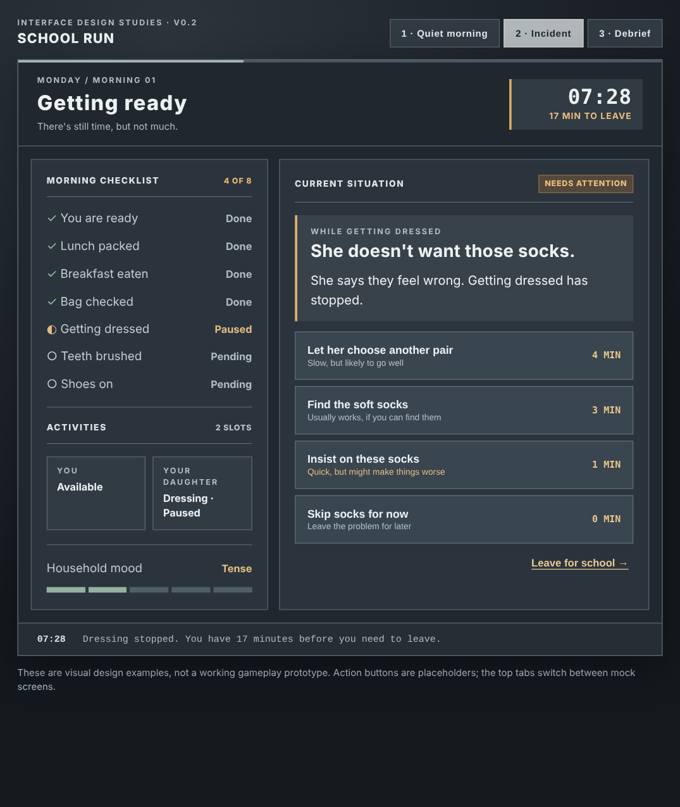

# School Run — Game Jam Design Specification (v0.2)

**Working title:** School Run (optional subtitle: *A Morning in Crisis*)  
**Format:** Single-player browser game, mouse/touch-first, turn-based time, 5–10 minutes per run  
**Jam fit:** *Don't Be Late* (primary); *Just In Time* (secondary)  
**Visual reference:** The industrial, serious crisis-management presentation of *Battlestar Galactica: Scattered Hopes* and *Crying Suns*—not their actual assets or exact layouts.

> **Pitch:** Get your child ready for school before the departure deadline. You can prepare quietly before she wakes, wake her early at a risk, give her tasks while you handle others, and respond to small disasters. Everything is presented with the severe visual language of a military strategy game; the writing itself stays almost entirely ordinary.

## 1. Design goals

1. **Treat the morning seriously.** Dark grey panels, terse reports, status indicators, restrained sound and a conspicuous clock provide the irony. The copy is mostly natural: “She won't put on those socks,” not “Footwear compliance failure.”
2. **The child isn't an opponent.** She has preferences, independence, tiredness, and occasional surprising priorities. The player manages time and their relationship, not an enemy health bar.
3. **Time is the principal currency.** You can inspect indefinitely. Only taking actions advances the simulated clock.
4. **Parallelism makes decisions interesting.** You do one hands-on activity; your child may do another on her own. Some tasks need supervision, and some proceed unattended until they don't.
5. **A morning can be imperfect and still succeed.** Leaving without finding the library book can be correct. Repeatedly insisting on perfect readiness should sometimes make you late.
6. **Small enough to finish.** One morning, one child, one parent, one home represented abstractly; no movement or room map, no backend.

**Core player question:** *Do I spend these minutes preparing, helping, negotiating, or just getting us out the door?*

## 2. A morning has two distinct phases

### A. 6:30 AM: The quiet window

The parent wakes at **6:30 AM**. The child is asleep and **normally wakes on her own at 7:00 AM**.

- While she is asleep, the player can do parent-only preparation without child interruptions: pack lunch, make breakfast, get dressed, find shoes, check the bag, or drink coffee.
- Each preparation consumes simulated minutes, so the player will not be able to do everything before 7:00.
- **Wake her now** is available at any time. Waking early buys child-active time but creates a temporary **groggy** condition and higher chance of stalls/escalations, stronger the earlier she's woken.
- Waiting until 7:00 avoids the wake penalty, but leaves less time for breakfast, dressing and other child-dependent tasks.
- When an action crosses 7:00, the child wakes naturally at 7:00 and the UI marks her as awake. The parent's current task can finish unless an event interrupts it.
- Don't add a separate sleep meter to the jam version. Display a plain-language warning before early waking (e.g. “Likely to be very tired” or “Slightly early”). The internal `groggyUntil` flag can expire after a short period.

**Illustrative prep actions** (tune for balance):

| Action | Minutes | Effect |
| --- | ---: | --- |
| Pack lunch | 8 | Lunch complete; removes one later obligation |
| Make breakfast | 7 | Child can eat promptly once awake |
| Get yourself ready | 8 | Parent readiness complete |
| Find shoes | 5 | Footwear found; averts one likely obstacle |
| Set out clothes | 4 | Dressing is easier/faster |
| Have coffee | 5 | One-use composure buffer against an incident |
| Wake child now | 0 | Child becomes available; potential grogginess |

At 6:30, the player cannot simply finish all six tasks in thirty minutes. Some actions have contingency value (finding shoes); others have certain value (packing lunch). This is a planning phase, not a separate minigame.

### B. 7:00 onward: The active morning

Once the child is awake, two things can progress concurrently:

- **Parent activity:** one task that uses the parent's time (e.g. pack lunch, help with hair, locate library book).
- **Child activity:** one assigned independent task (e.g. eat, dress, brush teeth, put on shoes). It may complete, pause for help, or spawn an incident.

Some things are prerequisites. Shoes cannot be put on before being found; teeth are best brushed after breakfast. Avoid making every activity dependent on a strict chain.

**Timing for the playable prototype:** Use **7:45 AM** as a *provisional* target to leave home, with a 15-minute commute and school starting at 8:00 AM. This is intentionally tighter than the former 8:20 target: 80 minutes after a natural wake-up would make the existing handful of short tasks trivially easy. If actual playtests favor 8:20, expand the task model or shorten the effective active window, rather than allowing 50 minutes of purposeless waiting. All clock values should be constants.

Late departure is allowed. When the child is sufficiently ready—or the player chooses to accept missing things—**Leave for school** ends the morning and opens the debrief.

## 3. Task and incident rules

### Activities and readiness

Suggested checklist for a first build:

| Objective | Usual owner | Approx. minutes | Dependencies / notes |
| --- | --- | ---: | --- |
| Parent ready | Parent | 8 | Can finish before wake-up |
| Lunch packed | Parent | 8 | Can finish before wake-up |
| Breakfast ready | Parent | 7 | Can finish before wake-up |
| Breakfast eaten | Child | 8 | Faster/easier if prepared |
| Dressed | Child | 8 | Clothes set out improves reliability |
| Teeth brushed | Child | 3 | Prefer after breakfast |
| Shoes on | Child | 4 | Requires found shoes |
| School bag checked | Parent | 4 | May expose a missing-item incident |

The player is not expected to complete everything. Playtesting should tune these numbers; consistency and predictability are more important than realism to the minute.

### Simulated time and interruptions

- The game pauses for the player's decisions. It never runs in real time.
- Start a parent activity, then advance to its completion **or the next incident**. Background child activity progresses over the same elapsed minutes.
- If the child is idle, the player can assign an activity for free while the clock is paused.
- When an incident occurs, pause and show the situation panel. The current task's progress is retained.
- Resolving an incident costs minutes. During those minutes, other independent activities may continue **unless the response specifically requires the parent and child**, in which case both are engaged. Declare this on the response.
- A **Wait / Continue** control advances to the next meaningful event; do not ask the player to click once per minute.
- Incidents may be deferred when plausible. They can block a task without blocking the entire morning.

### One simple social status

Show **Household mood** as a compact status label or 0–5 meter. It represents how the morning is going, not obedience or the child's value.

- Patient, flexible decisions may help mood at the cost of time.
- Rushing may save time but make a later problem more likely.
- Early waking applies a temporary *groggy* modifier to incidents, not a second permanent resource gauge.
- Show the general risks before action: “May make her upset,” “Reliable but takes time,” “Might save time.” Avoid hidden coin-flip traps.

### Example event: Socks

**What happened:** “She doesn't want to wear those socks. She says they feel wrong.”

| Response shown to player | Time | Consequence |
| --- | ---: | --- |
| Let her choose another pair | 4 min | Usually resolves; mood may improve |
| Find the soft socks | 3 min | Reliable if prepared / available |
| Insist on these socks | 1 min | Can escalate, especially if groggy |
| Skip socks for now | 0 min | Shoes remain incomplete; may create a car problem |

Copy should say **“Socks”**, not “Footwear Compliance Failure.” Let the surrounding industrial UI carry the joke.

### Example event: Wrong spoon

While the child eats, she stops. “She wanted the blue spoon.”

- Get the blue spoon: 2 min, breakfast resumes.
- Offer two choices: 2–4 min, possible mood improvement.
- Tell her to use this one: 1 min, escalation risk.
- Leave breakfast unfinished: 0 min, readiness tradeoff.

## 4. Visual language and layout

The aesthetic should resemble a serious, slightly worn sci-fi operations console. **Borrow principles, not exact UI composition, logos, game fonts, images or other proprietary assets.**

| Element | Treatment |
| --- | --- |
| Background | Charcoal and warm slate (`#171C22`, `#252D35`) |
| Panels | Layered blue-grey (`#303A43`) with 1px borders (`#53606B`) |
| Body text | Off-white (`#E4E9ED`); secondary text (`#AFBDC7`) |
| Warnings | Muted amber (`#D9AD64`); use red only for genuinely urgent items |
| Complete | Desaturated green (`#8AAE9B`) |
| Typography | Narrow, utilitarian headings; legible regular UI text; tabular clock figures |
| Ornament | Section numbers, small dividers, progress lines, timestamps; minimal texture |
| Audio | Soft mechanical clicks and an occasional understated alert—not constant alarms |

**Copy restraint:** ordinary task names and descriptions. Example: `Breakfast • Not started`, `Shoes • Missing`, `She doesn't want those socks`, `Offer another pair`. Optional severe headings like `CURRENT SITUATION`, `TIME REMAINING`, or `AFTER-ACTION REPORT` are enough.

### Screen A — 6:30 AM / Quiet window

The player needs one glance to understand: the child is asleep; waking her is a choice; preparations cost time.

```text
┌──────────────────────────────────────────────────────────────┐
│ SCHOOL RUN                       MONDAY  06:30  LEAVE 07:45 │
├──────────────────────────────────────────────────────────────┤
│ HOME STATUS                      │ RIGHT NOW                 │
│                                  │                           │
│ Child           ASLEEP           │ The house is quiet.       │
│ Usually wakes   07:00            │ She usually wakes at 7.   │
│ Household mood  CALM             │                           │
│                                  │ [Pack lunch]       8 min  │
│ Breakfast       Not started      │ [Make breakfast]   7 min  │
│ Lunch           Not packed       │ [Get ready]        8 min  │
│ Clothes         Not laid out     │ [Find shoes]       5 min  │
│ Shoes           Not checked      │                           │
│                                  │ [Wake her now]            │
│                                  │ Likely to be very tired.  │
├──────────────────────────────────────────────────────────────┤
│ 06:30   Nothing urgent. Yet.                                │
└──────────────────────────────────────────────────────────────┘
```

**Primary interaction:** clicking `Pack lunch` advances to 06:38 and completes lunch. `Wake her now` instead starts child-active tasks but leaves a groggy risk. The UI does not interrupt the player for each minute.

### Screen B — 7:28 AM / Incident

The player needs to see what's at stake without losing track of ongoing activities. The selected incident has 3–4 choices and a **Defer** control when appropriate.

```text
┌──────────────────────────────────────────────────────────────┐
│ SCHOOL RUN                    07:28   LEAVE BY 07:45   17m   │
├─────────────────────┬────────────────────────────────────────┤
│ TODAY'S TASKS       │ CURRENT SITUATION                      │
│ ✓ Lunch packed      │                                        │
│ ✓ Breakfast eaten   │ She doesn't want to wear those socks.  │
│ ~ Getting dressed   │ She says they feel wrong.              │
│ · Teeth             │                                        │
│ · Shoes             │ Let her choose another pair      4m   │
│ ✓ Bag checked       │ Find the soft socks              3m   │
│                     │ Insist on these socks            1m*  │
│ PARENT              │ Skip socks for now                0m  │
│ Free                │                                        │
│ CHILD               │ *Might make things worse               │
│ Dressing / paused   │                                        │
│                     │ [Leave for school]                     │
├─────────────────────┴────────────────────────────────────────┤
│ 07:28   Dressing stopped. Household mood: TENSE            │
└──────────────────────────────────────────────────────────────┘
```

**Response semantics:** every choice shows likely time and risk, without huge blocks of joke text. Picking a choice updates clock, task progress, mood, and activity availability. Incidents appear in context, not as arbitrary unskippable alerts.

### Screen C — End of morning / Debrief

```text
┌──────────────────────────────────────────────────────────────┐
│ SCHOOL RUN                                 MORNING COMPLETE  │
├──────────────────────────────────────────────────────────────┤
│ DEPARTED    07:47        ARRIVED     08:02      2 MIN LATE  │
│                                                              │
│ COMPLETED                      LEFT BEHIND                  │
│ ✓ Breakfast                   · Library book               │
│ ✓ Dressed                     · Matching socks             │
│ ✓ Lunch                       · A peaceful morning         │
│                                                              │
│ HOUSEHOLD MOOD  MIXED                                       │
│                                                              │
│ 07:12  Breakfast delayed by the wrong spoon.                │
│ 07:28  Sock dispute resolved by substitution.               │
│ 07:43  Bag found. Library book not found.                    │
│                                                              │
│ [TRY AGAIN]                              [SAME MORNING]     │
└──────────────────────────────────────────────────────────────┘
```

Debrief humor should be mainly juxtaposition. Avoid joke-overload and overly elaborate incident names.

### Companion visual examples

The spec ships with a standalone responsive HTML design preview and screenshots. The HTML's top tabs switch between three **illustrative** screens; the action buttons deliberately do not play the simulation.

- [Open the responsive design examples](school_run_design_examples.html)
- [Early morning screen](school_run_screen_quiet.png)
- [Incident screen](school_run_screen_crisis.png)
- [Debrief screen](school_run_screen_debrief.png)
- [Mobile incident layout](school_run_screen_mobile.png)





### Responsive/mobile design

Use one main column. Keep **current time / time to departure** visible. Below it, the primary situation and choices, then parent/child activities, readiness, and an optional collapsed event log. Buttons are large, full-width, never tiny tap targets. Do not make the player hunt through tabs for an urgent situation.

## 5. Content and replay

Start with **six to eight meaningful incidents**, keyed to tasks rather than inserted at arbitrary intervals:

- Wrong spoon (breakfast)
- Refused socks (dressing)
- Missing shoes (footwear / skipped prep)
- Spilled breakfast (clothes or breakfast)
- A fascinating bug (child distraction)
- Library book missing (bag check)
- Sudden bathroom need (before departure)
- Changed mind about outfit (dressing)

Each event should have at least two plausible responses, one quick but potentially risky, and one slower but stable. Resolve multiple conditions deterministically when possible; seed the smaller element of uncertainty for reproducible runs.

For variation use at most **one starting condition** and **one child tendency** per run, such as a late bedtime, missing lunch ingredient, unusually independent morning, or shoes already by the door. Conditions should affect something the player can observe.

## 6. Debrief, scoring and outcome

Score primarily on **on-time arrival and readiness**, with mood as a smaller consideration. Missing the target isn't a hard failure. A rushed but on-time morning can be a legitimate success; a slower, calmer morning may be worthwhile at a modest lateness cost.

Report actual departure and arrival times, completed and missing objectives, ending mood, and two or three notable events. Provide **Retry** and optionally **Replay same seed**. No progression or unlock system is necessary for the jam.

## 7. Technical outline

A React component with a pure simulation reducer is sufficient:

```ts
type GameState = {
  minute: number;                   // absolute minutes after midnight, starts 390
  departureDeadline: number;        // configurable; prototype example 465 (07:45)
  naturalWakeMinute: number;        // 420 (07:00)
  childAwake: boolean;
  groggyUntil?: number;             // transient condition, not a visible stat bar
  householdMood: 0 | 1 | 2 | 3 | 4 | 5;
  objectives: Record<string, TaskProgress>;
  parentActivity?: Activity;
  childActivity?: Activity;
  incidents: Incident[];
  currentIncidentId?: string;
  morningCondition: string;
  childTendency: string;
  rngSeed: number;
  history: EventLogEntry[];
  ended: boolean;
};
```

Actions must be deterministic for a given seed and player decisions. Whenever simulated time advances, independently progress active tasks, trigger the natural wake at 07:00 if applicable, test incident conditions, pause at the earliest meaningful event, and avoid counting minutes twice. An interrupted activity keeps its progress. End the run when the player chooses `Leave for school` or an optional generous safety cutoff is reached.

## 8. Jam build order

**Prototype 1: Clock and choice.** Start at 6:30. Add 4 parent prep actions, automatic 7:00 waking, early-wake penalty, child breakfast/dressing, and departure. Verify that **wake now vs prepare first** produces a real tradeoff.

**Prototype 2: Parallel morning.** Parent and child work independently, one incident (socks) blocks child activity, one incident (missing shoes) rewards earlier preparation, and a debrief summarizes the outcome.

**Prototype 3: Variation and presentation.** Add other incidents, seed replay, status visibility, responsive console styling, and small sound effects. Balance the departure deadline only after the basic scheduling loop works.

### Hard cuts

No deckbuilding, no persistent cards, no home floorplan/pathfinding, no inventory grid, no driving game, no school gameplay, no backend, no real-time countdown, no AI character dialogue, no elaborate military parody text.

### First playable acceptance criteria

1. Runs start at 6:30. The child wakes naturally at 7:00 unless woken earlier.
2. Pre-wake prep and early waking are both potentially viable openings.
3. Parent and child activities progress in parallel, with correctly accounted time.
4. Choices convey duration and consequence risk before commitment.
5. Incidents arise from the tasks and can interrupt without losing already spent progress.
6. The player can leave on time or late, prepared or underprepared.
7. Screens and choices are clear on a small phone, without custom graphics.
8. Most text is plain-language; the serious interface supplies the comedic contrast.

**North-star playtest:** Someone should be able to say, “I woke her early to get dressed, she hated it, so I spent ages on socks—but I had lunch ready and abandoned the missing book just in time.” That story should emerge from systems, not a scripted gag.
